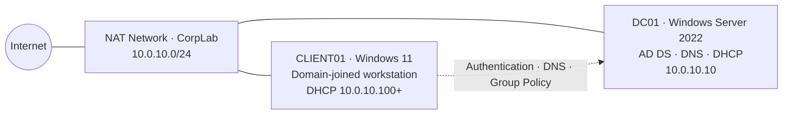

<div align="center">

# Enterprise Active Directory Home Lab

### Building a production-style Windows identity environment from the ground up

*Domain controller · DNS · DHCP · Group Policy · Access control · Identity lifecycle · Auditing · GRC*

<br/>


![PowerShell](https://img.shields.io/badge/PowerShell-Automation-5391FE?style=for-the-badge&logo=data:image/svg%2Bxml;base64,PHN2ZyBmaWxsPSJ3aGl0ZSIgeG1sbnM9Imh0dHA6Ly93d3cudzMub3JnLzIwMDAvc3ZnIiB4bWw6c3BhY2U9InByZXNlcnZlIiB2aWV3Qm94PSIwIDAgMTI4IDEyOCI%2BPHBhdGggZmlsbC1ydWxlPSJldmVub2RkIiBkPSJNMTI0LjkxMiAxOS4zNThjLS45NjItMS4xOTktMi40MjItMS44NTgtNC4xMTEtMS44NThoLTkyLjYxYy0zLjM5NyAwLTYuNjY1IDIuNjQyLTcuNDQ0IDYuMDE1TDIuMTYyIDEwNC4wMjJjLS4zOTYgMS43MTEtLjA1OCAzLjM5NC45MjYgNC42MTkuOTYzIDEuMTk5IDIuNDIzIDEuODU4IDQuMTExIDEuODU4di4wMDFIOTkuODFjMy4zOTYgMCA2LjY2NS0yLjY0MyA3LjQ0My02LjAxNmwxOC41ODYtODAuNTA4Yy4zOTUtMS43MTEuMDU3LTMuMzk1LS45MjctNC42MTh6bS05OC41ODkgNzcuMTdjLTEuNzQzLTIuMzk3LTEuMzIzLTUuNjczLjk0LTcuMzE4bDM3LjM3OS0yNy4wNjd2LS41NTZMNDEuMTU3IDM2LjYwM2MtMS45MTYtMi4wMzgtMS43MTYtNS4zMzMuNDQ1LTcuMzYxIDIuMTYyLTIuMDI3IDUuNDY2LTIuMDE5IDcuMzgyLjAxOWwyOC4xOCAyOS45NzljMS42IDEuNzAyIDEuNzE4IDQuMjc5LjQ1NyA2LjI2NC0uMzg0Ljc3NC0xLjE4MiAxLjYyOC0yLjU5MyAyLjYxOGwtNDEuNDUgMjkuNzY5Yy0yLjI2MyAxLjY0NC01LjUxMiAxLjAzNC03LjI1NS0xLjM2M3ptNTkuNTQzLjUzOEg2My41MzJjLTIuNTk3IDAtNC43MDItMi4wODItNC43MDItNC42NXMyLjEwNS00LjY1IDQuNzAyLTQuNjVoMjIuMzMzYzIuNTk3IDAgNC43MDIgMi4wODIgNC43MDIgNC42NXMtMi4xMDQgNC42NS00LjcwMSA0LjY1eiIgY2xpcC1ydWxlPSJldmVub2RkIi8%2BPC9zdmc%2BCg%3D%3D)


<br/>

<a href="#about-this-project"></a>
<a href="#architecture"></a>
<a href="#the-five-phases"></a>
<a href="#highlights"></a>
<a href="#skills-demonstrated"></a>
<a href="#open-to-opportunities"></a>

</div>

---

## About this project

I've managed Active Directory in real production environments, with real users, groups and access requests. This lab is a deliberate **back-to-basics rebuild**: every layer of an enterprise Windows identity stack built from scratch on one laptop, with the reasoning behind each decision documented along the way.

It mirrors what IT and IAM teams handle every day:

- **Stand up** a domain with the core network services it depends on
- **Structure** identities by department, role and privilege level
- **Enforce** security policy on every endpoint
- **Control** who can reach which data, and prove it
- **Manage** the full joiner–mover–leaver lifecycle, with an audit trail for every change

---

## Architecture



<div align="center">

**Domain** `corp.kudzaishelab.local` · **Network** `10.0.10.0/24` · **Identities** 20+ users across IT, HR, Finance and Sales

</div>

---

## The five phases

The full lab is built and tested. Each phase's write-up is published as it's finished.

**Phase 1 · [Lab foundation and domain controller](phase-1-foundation/)** ✅
Isolated network, domain controller promotion, DNS zones and forwarders, DHCP authorization and scopes.
`▰▰▰▰▰▰▰▰▰▰` **100%** · Built · Documented · Published

**Phase 2 · [Identity structure](phase-2-identity/)** ✅
Departmental OUs, AGDLP security groups, bulk user provisioning from CSV, and privileged account separation.
`▰▰▰▰▰▰▰▰▰▰` **100%** · Built · Documented · Published

**Phase 3 · Endpoint integration and Group Policy**
Domain-joined Windows 11 workstation, password and lockout policy, fine-grained password policy, and workstation hardening.
`▰▰▰▰▰▰▰▱▱▱` **70%** · Built · Write-up in progress

**Phase 4 · Access control**
Group-based NTFS and share permissions following the AGDLP model, proven with least-privilege access tests.
`▰▰▰▰▰▰▰▱▱▱` **70%** · Built · Write-up in progress

**Phase 5 · IAM lifecycle and auditing**
Joiner, mover and leaver processes, helpdesk delegation, lockout recovery, deleted-object restore, and security auditing.
`▰▰▰▰▰▰▰▱▱▱` **70%** · Built · Write-up in progress

---

## Highlights

- **20 users provisioned in seconds** from a CSV with PowerShell, each placed in the right OU and role group automatically
- **Least privilege, proven:** Finance can edit its share, HR is denied, and one group change grants HR read-only access, with no folder permissions touched
- **Six identity scenarios run end to end:** joiner, mover, leaver, helpdesk delegation, account lockout and deleted-user restore
- **Three Group Policies enforced and verified** with `gpresult`: domain password and lockout rules, workstation hardening, and a departmental Control Panel restriction
- **Every change leaves evidence:** account creation, group changes, disables and lockouts captured in the Security log (Event IDs 4720, 4728, 4725, 4740)
- **Real troubleshooting, documented:** a domain controller network profile blocking client DNS, a VM with no attached disk, and policies missing their target OU

---

## Skills demonstrated

<div align="center">

**Infrastructure**


![PowerShell](https://img.shields.io/badge/PowerShell_automation-0078D4?style=flat-square&logo=data:image/svg%2Bxml;base64,PHN2ZyBmaWxsPSJ3aGl0ZSIgeG1sbnM9Imh0dHA6Ly93d3cudzMub3JnLzIwMDAvc3ZnIiB4bWw6c3BhY2U9InByZXNlcnZlIiB2aWV3Qm94PSIwIDAgMTI4IDEyOCI%2BPHBhdGggZmlsbC1ydWxlPSJldmVub2RkIiBkPSJNMTI0LjkxMiAxOS4zNThjLS45NjItMS4xOTktMi40MjItMS44NTgtNC4xMTEtMS44NThoLTkyLjYxYy0zLjM5NyAwLTYuNjY1IDIuNjQyLTcuNDQ0IDYuMDE1TDIuMTYyIDEwNC4wMjJjLS4zOTYgMS43MTEtLjA1OCAzLjM5NC45MjYgNC42MTkuOTYzIDEuMTk5IDIuNDIzIDEuODU4IDQuMTExIDEuODU4di4wMDFIOTkuODFjMy4zOTYgMCA2LjY2NS0yLjY0MyA3LjQ0My02LjAxNmwxOC41ODYtODAuNTA4Yy4zOTUtMS43MTEuMDU3LTMuMzk1LS45MjctNC42MTh6bS05OC41ODkgNzcuMTdjLTEuNzQzLTIuMzk3LTEuMzIzLTUuNjczLjk0LTcuMzE4bDM3LjM3OS0yNy4wNjd2LS41NTZMNDEuMTU3IDM2LjYwM2MtMS45MTYtMi4wMzgtMS43MTYtNS4zMzMuNDQ1LTcuMzYxIDIuMTYyLTIuMDI3IDUuNDY2LTIuMDE5IDcuMzgyLjAxOWwyOC4xOCAyOS45NzljMS42IDEuNzAyIDEuNzE4IDQuMjc5LjQ1NyA2LjI2NC0uMzg0Ljc3NC0xLjE4MiAxLjYyOC0yLjU5MyAyLjYxOGwtNDEuNDUgMjkuNzY5Yy0yLjI2MyAxLjY0NC01LjUxMiAxLjAzNC03LjI1NS0xLjM2M3ptNTkuNTQzLjUzOEg2My41MzJjLTIuNTk3IDAtNC43MDItMi4wODItNC43MDItNC42NXMyLjEwNS00LjY1IDQuNzAyLTQuNjVoMjIuMzMzYzIuNTk3IDAgNC43MDIgMi4wODIgNC43MDIgNC42NXMtMi4xMDQgNC42NS00LjcwMSA0LjY1eiIgY2xpcC1ydWxlPSJldmVub2RkIi8%2BPC9zdmc%2BCg%3D%3D)

**Identity and access**


**Security and operations**


**Governance and compliance**


</div>

<details>
<summary><b>View GRC control mapping</b></summary>

<br/>

- **Joiner / mover / leaver process** → NIST AC-2 Account Management · CIS 5 Account Management
- **Least privilege and helpdesk delegation** → NIST AC-6 Least Privilege · CIS 6 Access Control Management
- **Separate privileged admin accounts** → NIST AC-6(5) Privileged Accounts · CIS 5.4 Restrict Admin Privileges
- **Password, lockout and fine-grained policy** → NIST IA-5 Authenticator Management, AC-7 Unsuccessful Logon Attempts · CIS 5.2 Use Unique Passwords
- **Advanced audit policy and event review** → NIST AU-2 Event Logging, AU-6 Audit Review · CIS 8 Audit Log Management
- **Workstation hardening via Group Policy** → NIST CM-6 Configuration Settings · CIS 4 Secure Configuration

</details>

<details>
<summary><b>View repository structure</b></summary>

<br/>

```
AD-Enterprise-Home-Lab/
├── README.md                     ← you are here
├── phase-1-foundation/
│   ├── README.md                 ← lab foundation and domain controller
│   └── screenshots/
└── phase-2-identity/
    ├── README.md                 ← identity structure
    ├── scripts/                  ← PowerShell scripts and users.csv
    └── screenshots/
```

New phase folders are added as each write-up is published.

</details>

---

<div align="center">

## Open to opportunities

**IAM Engineer** · **GRC Analyst** · **Cybersecurity Analyst** · **SOC Analyst** · **Cloud Security Engineer** · **IT Support / Systems Administrator**

New York / New Jersey · Remote

<br/>

**Kudzaishe Rutsinga** · M.S. Cybersecurity, Yeshiva University
*CompTIA Security+ · ISC2 CC · Microsoft AZ-900*

[](https://www.linkedin.com/in/kudzaishe-rutsinga/)
[](https://kudzaishe-cloud.github.io)
[](https://github.com/Kudzaishe-Cloud)

</div>
