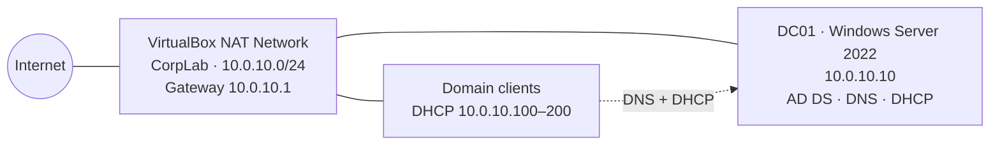

# Phase 1 – Lab Foundation and Domain Controller

**Enterprise Active Directory Home Lab · Phase 1 of 5**

In this phase I built the foundation of a small corporate network on one laptop: an isolated virtual network and a Windows Server 2022 **domain controller (DC01)** running **Active Directory Domain Services (AD DS)**, **DNS** and **DHCP** for the domain `corp.kudzaishelab.local`.

Everything in later phases (users, Group Policy, file permissions and the identity lifecycle) is built on top of this.

---

## Contents

1. [Key terms](#key-terms)
2. [Lab design](#lab-design)
3. [Build steps](#build-steps)
4. [Verification](#verification)
5. [Troubleshooting](#troubleshooting)
6. [Skills demonstrated](#skills-demonstrated)

---

## Key terms

### Active Directory

| Term | Meaning |
|---|---|
| **Active Directory (AD)** | Microsoft's directory service. It stores every user, computer and group in an organization, and controls who can log in and what they can access. |
| **AD DS** | Active Directory Domain Services, the server role that runs Active Directory. |
| **Domain controller (DC)** | A server running AD DS. It authenticates logins and holds a copy of the directory. |
| **Domain** | A group of users and computers managed together under one name, here `corp.kudzaishelab.local`. |
| **Forest** | The top-level container in AD and its security boundary. It holds one or more domains. This lab has one forest with one domain. |
| **Promotion** | Turning a normal server into a domain controller. |
| **FQDN** | Fully Qualified Domain Name, the complete name of a host or domain, such as `dc01.corp.kudzaishelab.local`. |
| **NetBIOS name** | A short, legacy domain name (max 15 characters) used in logins like `KUDZAISHELAB\username`. |
| **Global Catalog** | A searchable index of objects across the whole forest, hosted on the DC. |
| **DSRM** | Directory Services Restore Mode, an emergency login with its own password, used to repair or restore AD when it is broken. |
| **AD Recycle Bin** | A feature that lets deleted objects be restored with all their attributes and group memberships. |

### DNS

| Term | Meaning |
|---|---|
| **DNS** | Domain Name System. It translates names into IP addresses, like a phone book for the network. AD cannot work without it. |
| **Forward lookup** | Name → IP address (`dc01.corp.kudzaishelab.local` → `10.0.10.10`). |
| **Reverse lookup (reverse DNS)** | IP address → name (`10.0.10.10` → `dc01`). Useful in logs and troubleshooting. |
| **Zone** | The section of DNS a server is responsible for. A *forward lookup zone* holds name-to-IP records; a *reverse lookup zone* holds IP-to-name records. |
| **AD-integrated zone** | A DNS zone stored inside Active Directory, so it replicates securely to every DC. |
| **A record** | Maps a hostname to an IPv4 address. |
| **PTR record** | Pointer record, the reverse of an A record: maps an IP to a hostname. |
| **SRV record** | Service record. Tells clients which server provides a service. Computers use SRV records to find a domain controller. |
| **DNS forwarder** | An external DNS server that queries are passed to when the local server doesn't know the answer, such as public websites. |

### DHCP and networking

| Term | Meaning |
|---|---|
| **DHCP** | Dynamic Host Configuration Protocol. It automatically gives devices an IP address and network settings. |
| **Scope** | The range of IP addresses a DHCP server can hand out. |
| **Scope options** | Extra settings sent with each address: **003** Router (gateway), **006** DNS server, **015** DNS domain name. |
| **DHCP authorization** | Approving a DHCP server in AD before it can issue addresses. Blocks rogue DHCP servers. |
| **Lease** | How long a client keeps an address before renewing it (8 days by default). |
| **Static IP** | A fixed, manually set IP address. Servers, especially DCs, need one so clients can always find them. |
| **Default gateway** | The router a device uses to reach other networks and the internet. |
| **Subnet / CIDR (/24)** | A block of addresses. `10.0.10.0/24` means `10.0.10.1`–`10.0.10.254`, subnet mask `255.255.255.0`. |
| **NAT Network** | A VirtualBox network where VMs share a private subnet, can talk to each other and reach the internet through NAT. |
| **Network profile** | How Windows classifies a network (*Domain*, *Private* or *Public*). It decides which firewall rules apply. |

---

## Lab design



| Setting | Value |
|---|---|
| Hypervisor | Oracle VirtualBox on a Windows 11 Home host (16 GB RAM) |
| Lab network | NAT Network `CorpLab` – `10.0.10.0/24` |
| Default gateway | `10.0.10.1` (VirtualBox NAT router) |
| Domain controller | `DC01` – `10.0.10.10` (static) · 4 GB RAM · 2 vCPU · 60 GB disk |
| Domain (FQDN) / NetBIOS | `corp.kudzaishelab.local` / `KUDZAISHELAB` |
| DHCP scope | `10.0.10.100` – `10.0.10.200` |
| DNS forwarders | `1.1.1.1` (Cloudflare), `8.8.8.8` (Google) |

---

## Build steps

### 1. Create the isolated lab network

Created a **NAT Network** so the VMs can reach the internet and each other, while staying separate from the host's home network. VirtualBox's built-in DHCP was **disabled** because DC01 acts as the DHCP server, as it would in a real organization.

```powershell
VBoxManage natnetwork add --netname CorpLab --network "10.0.10.0/24" --enable --dhcp off
```

### 2. Create the DC01 VM and install Windows Server

- Disabled VirtualBox's **unattended installation**, which would otherwise create its own local account and placeholder domain.
- Attached the network adapter to **NAT Network → CorpLab**.
- Installed **Windows Server 2022 Standard (Desktop Experience)**, the edition with a full GUI.
- Installed Guest Additions and took a baseline snapshot.


### 3. Rename the server and set a static IP

A domain controller needs a **permanent name and address**, because every client locates the domain through it. The server was renamed *before* promotion, since renaming an existing DC is complex and risky. DC01 points DNS at **itself** because it hosts the domain's DNS.

```powershell
Rename-Computer -NewName DC01 -Restart
New-NetIPAddress -InterfaceAlias "Ethernet" -IPAddress 10.0.10.10 -PrefixLength 24 -DefaultGateway 10.0.10.1
Set-DnsClientServerAddress -InterfaceAlias "Ethernet" -ServerAddresses 10.0.10.10
```


### 4. Install AD DS and promote DC01

Installed the **AD DS role**, then promoted DC01 to the first domain controller of a **new forest**, with integrated DNS and a DSRM recovery password.

```powershell
Install-WindowsFeature AD-Domain-Services -IncludeManagementTools
Install-ADDSForest -DomainName "corp.kudzaishelab.local" -DomainNetbiosName "KUDZAISHELAB" -InstallDns `
  -SafeModeAdministratorPassword (Read-Host -AsSecureString "DSRM password")
```

The DNS delegation warnings during promotion are expected in a lab with no parent domain.


### 5. Enable the AD Recycle Bin

Without the Recycle Bin, a restored user comes back **without their group memberships**. Enabling it is permanent for the forest.

```powershell
Enable-ADOptionalFeature 'Recycle Bin Feature' -Scope ForestOrConfigurationSet -Target corp.kudzaishelab.local
```


### 6. Configure DNS

During promotion, Windows automatically created the domain's forward lookup zone, including the **SRV records** (`_msdcs`, `_sites`, `_tcp`) that clients use to find a domain controller. I then added **forwarders** for internet names and a **reverse lookup zone** for IP-to-name lookups.

```powershell
Add-DnsServerForwarder -IPAddress 1.1.1.1, 8.8.8.8
Add-DnsServerPrimaryZone -NetworkId "10.0.10.0/24" -ReplicationScope Forest
```


### 7. Install, authorize and configure DHCP

Installed DHCP, **authorized** it in AD, and created the `Corp-Clients` scope with options for the gateway (003), DNS server (006) and domain name (015). Option 006 is critical: clients that don't use DC01 for DNS cannot find or join the domain.

```powershell
Install-WindowsFeature DHCP -IncludeManagementTools
netsh dhcp add securitygroups
Restart-Service dhcpserver
Add-DhcpServerInDC -DnsName dc01.corp.kudzaishelab.local -IPAddress 10.0.10.10
Add-DhcpServerv4Scope -Name "Corp-Clients" -StartRange 10.0.10.100 -EndRange 10.0.10.200 -SubnetMask 255.255.255.0
Set-DhcpServerv4OptionValue -ScopeId 10.0.10.0 -DnsServer 10.0.10.10 -DnsDomain corp.kudzaishelab.local -Router 10.0.10.1
```


---

## Verification

| Check | Command | Expected result |
|---|---|---|
| Static IP and DNS | `ipconfig /all` | IP `10.0.10.10`, gateway `10.0.10.1`, DNS `10.0.10.10`, DHCP disabled |
| Domain exists | `Get-ADDomain \| Select DNSRoot, NetBIOSName` | `corp.kudzaishelab.local` · `KUDZAISHELAB` |
| Internet DNS works | `Resolve-DnsName google.com` | Public IPs returned through the forwarders |
| DHCP authorized | `Get-DhcpServerInDC` | `dc01.corp.kudzaishelab.local` · `10.0.10.10` |
| Scope active | `Get-DhcpServerv4Scope` | `Corp-Clients` · State `Active` |
| Network profile | `Get-NetConnectionProfile` | NetworkCategory `DomainAuthenticated` |


---

## Troubleshooting

### Clients couldn't resolve DNS after a reboot

- **Symptom:** DNS worked on DC01 itself, but queries from a client timed out.
- **Diagnosis:** `Get-NetConnectionProfile` showed DC01's network category as **Public** instead of **DomainAuthenticated**, so Windows Firewall applied the public profile and blocked inbound DNS.
- **Cause:** at boot, the Network Location Awareness (NLA) service started before the DNS service was ready, so it couldn't recognize the domain network. This is a known domain controller behaviour.
- **Fix:** restarted the adapter to force re-detection, and made NLA depend on DNS so it doesn't recur after future reboots.

```powershell
Restart-NetAdapter -Name "Ethernet"
sc.exe config NlaSvc depend= NSI/RpcSs/Nsi/TcpIp/Dhcp/Eventlog/DNS
```


### Other lessons

- **NAT vs NAT Network:** plain NAT isolates each VM from the others. The lab needs a NAT Network, which only appears in VirtualBox's Expert mode.
- **Unattended installation:** disabling it keeps full control over accounts, edition and settings.

**Key takeaway:** most Active Directory problems trace back to DNS, so check DNS first.

---

## Skills demonstrated

Windows Server 2022 · Active Directory Domain Services · forest and domain design · DNS (AD-integrated zones, SRV records, forwarders, reverse lookup) · DHCP (authorization, scopes, options) · PowerShell administration · virtual networking · systematic troubleshooting

---

**Next → [Phase 2: Identity Structure](../phase-2-identity/)**
Organizational Units, role-based security groups (AGDLP), bulk user provisioning from CSV, and a separate privileged admin account.
