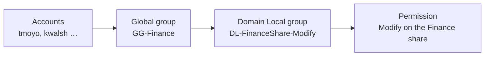
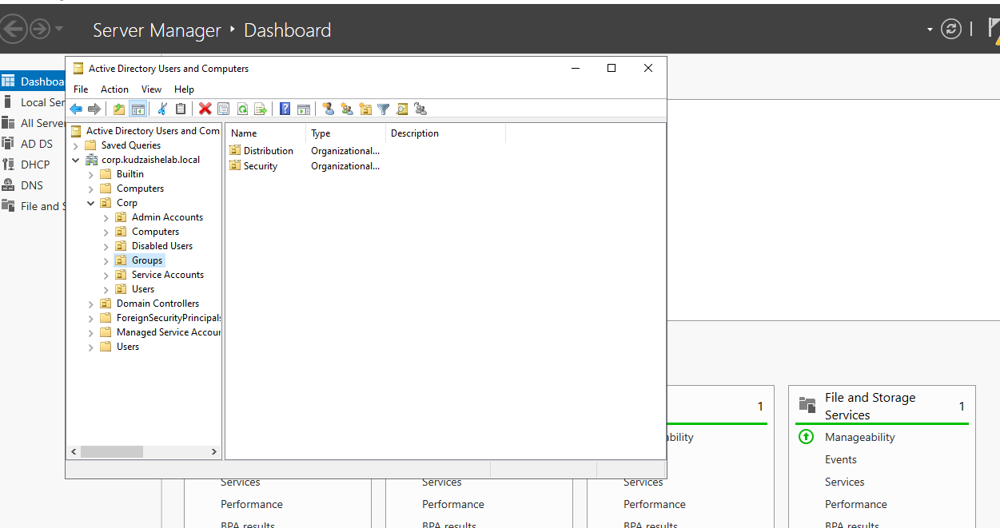
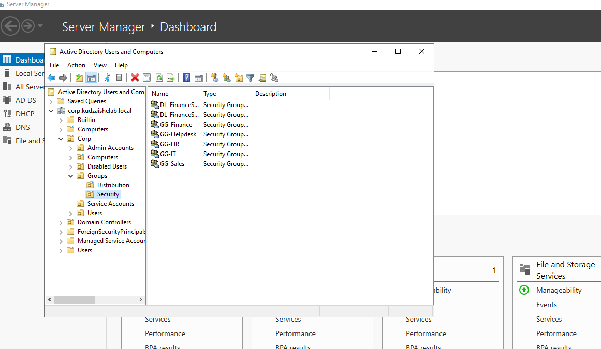
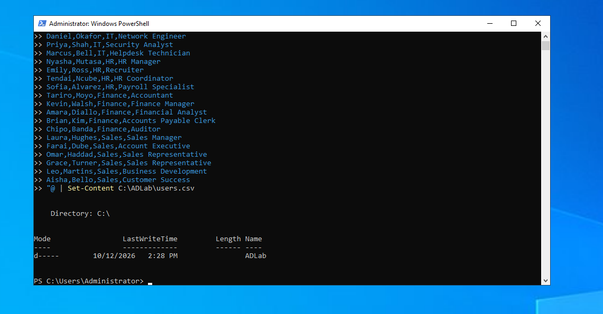
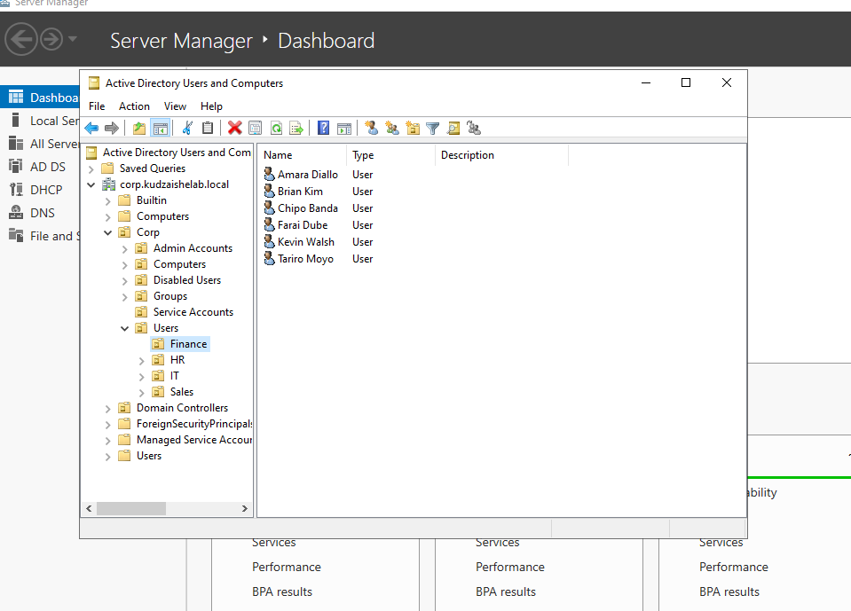
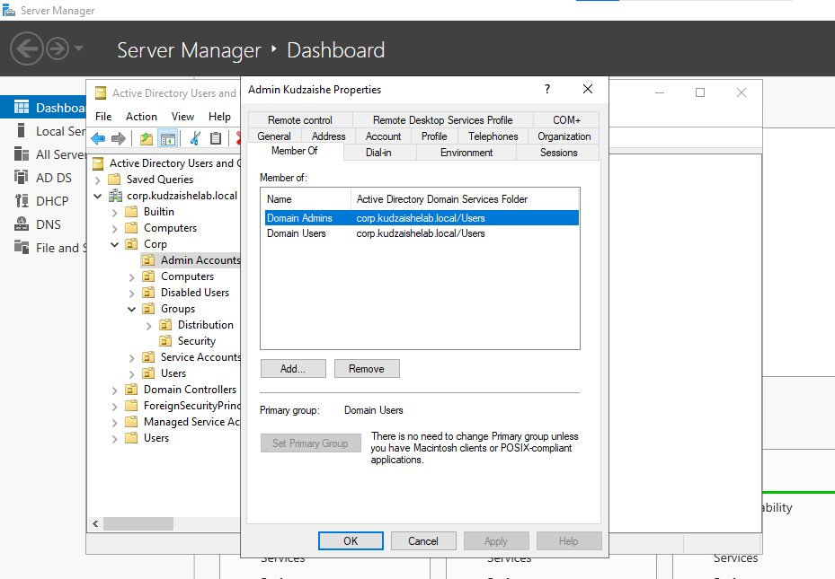
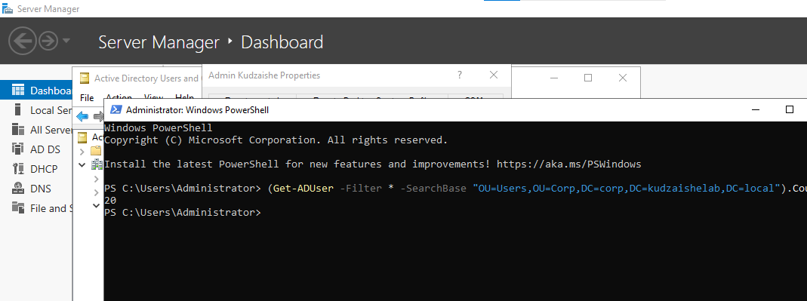
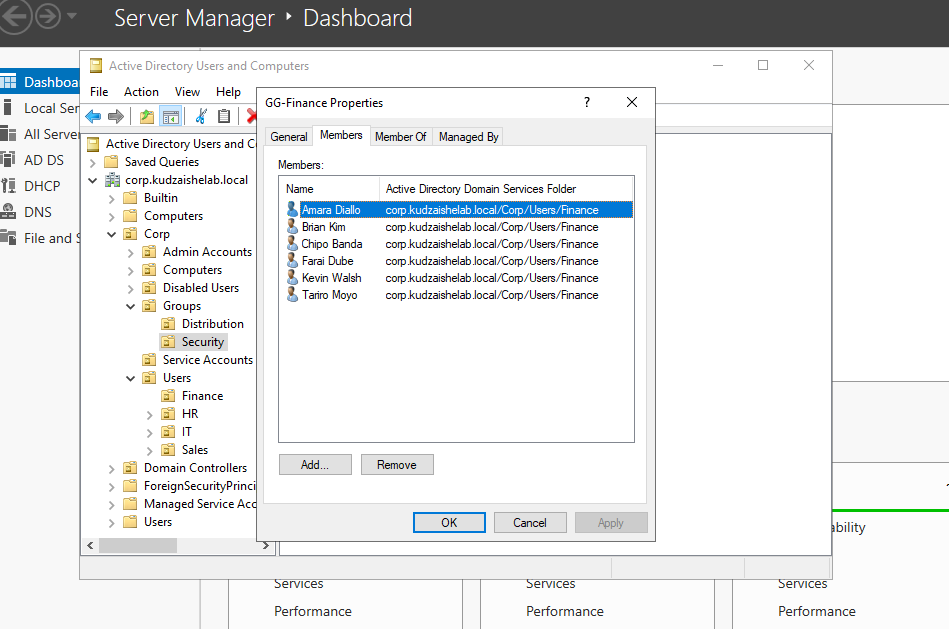

# Phase 2 – Identity Structure

**Enterprise Active Directory Home Lab · Phase 2 of 5**

In this phase I built the organization inside the domain: an **Organizational Unit (OU)** structure that mirrors a real company, **role-based security groups** following the **AGDLP** model, **20 users provisioned in seconds** from a CSV with PowerShell, and a **separate privileged account** for administration.

This structure is what makes every later phase possible. Group Policy targets OUs (Phase 3), file access is granted through groups (Phase 4), and the identity lifecycle moves users between both (Phase 5).

---

## Contents

1. [Key terms](#key-terms)
2. [Design](#design)
3. [Build steps](#build-steps)
4. [Verification](#verification)
5. [Lessons learned](#lessons-learned)
6. [Scripts](#scripts)
7. [Skills demonstrated](#skills-demonstrated)

---

## Key terms

| Term | Meaning |
|---|---|
| **Organizational Unit (OU)** | A container in Active Directory for users, computers and groups. OUs are where **Group Policy is linked** and where **admin rights are delegated**. |
| **Container vs OU** | The built-in `Users` and `Computers` folders are *containers*, not OUs. They can't have Group Policy linked to them, which is why real environments build their own OU tree. |
| **Distinguished Name (DN)** | An object's full path in AD, read right to left, e.g. `CN=Tariro Moyo,OU=Finance,OU=Users,OU=Corp,DC=corp,DC=kudzaishelab,DC=local`. |
| **Security group** | A group that can be granted permissions. A *distribution* group is for email only. |
| **Group scope** | Where a group can be used. **Global** groups hold users from the same domain (roles). **Domain Local** groups are given permissions on resources. |
| **AGDLP** | Microsoft's recommended permission model: **A**ccounts go into **G**lobal groups, Global groups go into **D**omain **L**ocal groups, and Domain Local groups get **P**ermissions. |
| **RBAC** | Role-Based Access Control: access is granted by role (department, job function), not to individuals. |
| **sAMAccountName** | The pre-Windows 2000 logon name, used as `KUDZAISHELAB\tmoyo`. |
| **User Principal Name (UPN)** | The email-style logon name, `tmoyo@corp.kudzaishelab.local`. |
| **Provisioning** | Creating an account with the correct attributes, location and access, ready for the user's first day. |
| **Tiered administration** | Separating everyday accounts from privileged admin accounts, so a compromised daily account never holds Domain Admin rights. |

---

## Design

### OU structure

```
corp.kudzaishelab.local
└── Corp
    ├── Users
    │   ├── IT
    │   ├── HR
    │   ├── Finance
    │   └── Sales
    ├── Computers
    │   ├── Workstations
    │   └── Servers
    ├── Groups
    │   ├── Security
    │   └── Distribution
    ├── Admin Accounts
    ├── Service Accounts
    └── Disabled Users
```

Each branch has a purpose:

- **Users** is split by department, so policy and delegation can target one department without affecting others.
- **Computers** separates workstations from servers, because they need different security baselines.
- **Admin Accounts** keeps privileged identities apart from standard users.
- **Disabled Users** is the holding area for offboarded accounts (used in Phase 5).

### The AGDLP model



This phase builds the first two layers: **accounts** and **global role groups**. Domain Local groups and permissions are added in Phase 4. When someone changes department, one group membership changes; no folder permissions are ever edited.

---

## Build steps

All steps run on **DC01** in PowerShell as Administrator. The full scripts are in the [`scripts`](scripts/) folder.

### 1. Create the OU structure

A top-level `Corp` OU keeps all company objects separate from AD's built-in containers. One loop per branch creates the whole tree in seconds.

```powershell
$base = "DC=corp,DC=kudzaishelab,DC=local"
$corp = "OU=Corp,$base"

New-ADOrganizationalUnit -Name "Corp" -Path $base
"Users","Computers","Groups","Admin Accounts","Service Accounts","Disabled Users" |
  ForEach-Object { New-ADOrganizationalUnit -Name $_ -Path $corp }
"IT","HR","Finance","Sales" |
  ForEach-Object { New-ADOrganizationalUnit -Name $_ -Path "OU=Users,$corp" }
```

New OUs are **protected from accidental deletion** by default.



### 2. Create role-based security groups

Five **Global security groups**, one per role, named with a `GG-` prefix so their scope is clear at a glance.

```powershell
$sec = "OU=Security,OU=Groups,$corp"
"IT","HR","Finance","Sales","Helpdesk" | ForEach-Object {
  New-ADGroup -Name "GG-$_" -GroupScope Global -GroupCategory Security -Path $sec
}
```



*The two `DL-FinanceShare` groups also visible here are added in Phase 4.*

### 3. Bulk-provision 20 users from CSV

The user list lives in [`users.csv`](scripts/users.csv) (first name, last name, department, title). The import script reads each row and:

1. Builds the username from **first initial + last name** (`Tariro Moyo` → `tmoyo`)
2. Sets the **sAMAccountName**, **UPN**, department and job title
3. Places the account in its **department OU**
4. Adds it to its **department role group**
5. Forces a **password change at first logon**, so the temporary password never stays in use

```powershell
$tempPassword = Read-Host -AsSecureString "Temporary password for new users"

Import-Csv .\users.csv | ForEach-Object {
  $sam = ($_.FirstName.Substring(0,1) + $_.LastName).ToLower()
  New-ADUser -Name "$($_.FirstName) $($_.LastName)" -GivenName $_.FirstName -Surname $_.LastName `
    -SamAccountName $sam -UserPrincipalName "$sam@corp.kudzaishelab.local" `
    -Department $_.Department -Title $_.Title `
    -Path "OU=$($_.Department),OU=Users,$corp" `
    -AccountPassword $tempPassword -ChangePasswordAtLogon $true -Enabled $true
  Add-ADGroupMember -Identity "GG-$($_.Department)" -Members $sam
}
```

The two helpdesk technicians are also added to `GG-Helpdesk`, which receives delegated rights in Phase 5.




### 4. Create a separate privileged account

Daily work uses a standard account. Administration uses **`adm-kudzaishe`**, stored in the `Admin Accounts` OU and added to **Domain Admins**. If an everyday account is phished, the attacker does not gain domain-wide control.

```powershell
New-ADUser -Name "Admin Kudzaishe" -SamAccountName "adm-kudzaishe" `
  -UserPrincipalName "adm-kudzaishe@corp.kudzaishelab.local" `
  -Path "OU=Admin Accounts,$corp" `
  -AccountPassword (Read-Host -AsSecureString "Admin password") -Enabled $true
Add-ADGroupMember -Identity "Domain Admins" -Members "adm-kudzaishe"
```



---

## Verification

| Check | Command | Expected result |
|---|---|---|
| OU tree exists | `Get-ADOrganizationalUnit -SearchBase $corp -Filter * \| Select Name` | All 15 OUs listed |
| Role groups exist | `Get-ADGroup -Filter 'Name -like "GG-*"' \| Select Name` | GG-IT, GG-HR, GG-Finance, GG-Sales, GG-Helpdesk |
| All users created | `(Get-ADUser -Filter * -SearchBase "OU=Users,$corp").Count` | `20` |
| Group membership | `Get-ADGroupMember GG-Finance \| Select Name` | The Finance staff |
| Admin rights | `Get-ADPrincipalGroupMembership adm-kudzaishe \| Select Name` | Includes `Domain Admins` |




---

## Lessons learned

- **Containers aren't OUs.** AD's default `Users` folder looks like an OU but can't take Group Policy. Building a dedicated `Corp` tree avoids that limit from day one.
- **Scripts beat clicks for consistency.** Creating 20 users by hand risks typos in usernames, OUs and groups. One script applies the same rules to every account, and can be re-run in any new lab.
- **Never hard-code passwords.** The scripts prompt with `Read-Host -AsSecureString`, so no credential is stored in a file or committed to Git.
- **PowerShell variables don't persist.** Closing the window clears `$corp` and `$base`; each script defines its own so it runs on its own.

---

## Scripts

| File | Purpose |
|---|---|
| [`01-create-ou-structure.ps1`](scripts/01-create-ou-structure.ps1) | Builds the full OU tree |
| [`02-create-role-groups.ps1`](scripts/02-create-role-groups.ps1) | Creates the GG- role groups |
| [`users.csv`](scripts/users.csv) | The 20 lab users (fictional) |
| [`03-import-users.ps1`](scripts/03-import-users.ps1) | Bulk-provisions users from the CSV |
| [`04-create-admin-account.ps1`](scripts/04-create-admin-account.ps1) | Creates the separate privileged account |

---

## Skills demonstrated

Active Directory OU design · RBAC and the AGDLP model · security group scopes · bulk identity provisioning · PowerShell automation · tiered (privileged) administration · secure credential handling in scripts

**GRC alignment:** NIST AC-2 Account Management · NIST AC-6(5) Privileged Accounts · CIS Control 5 Account Management · CIS 5.4 Restrict Administrator Privileges

---

**← [Phase 1: Lab foundation](../phase-1-foundation/)** · **Next → [Phase 3: Endpoint integration and Group Policy](../phase-3-group-policy/)**
