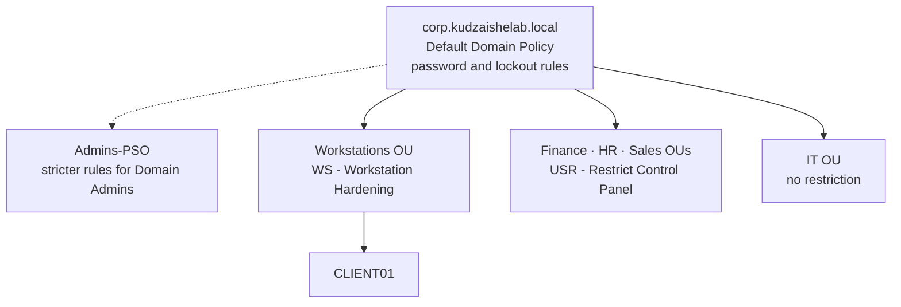
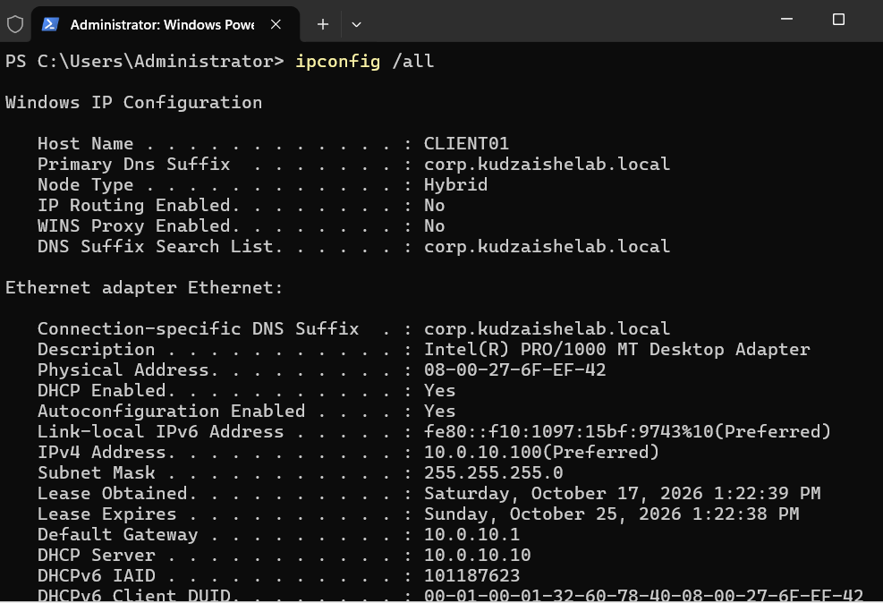
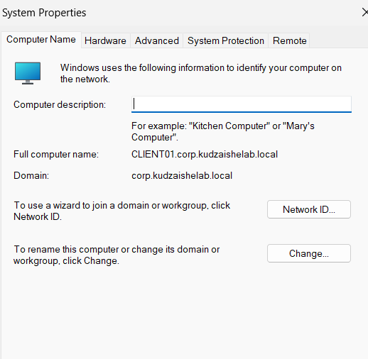
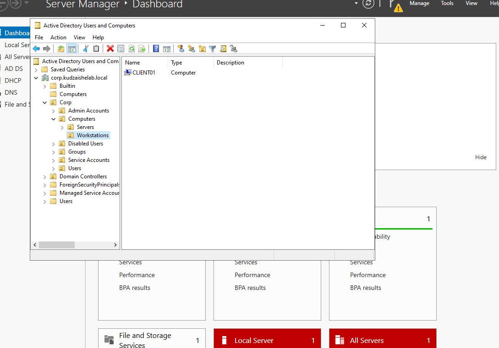
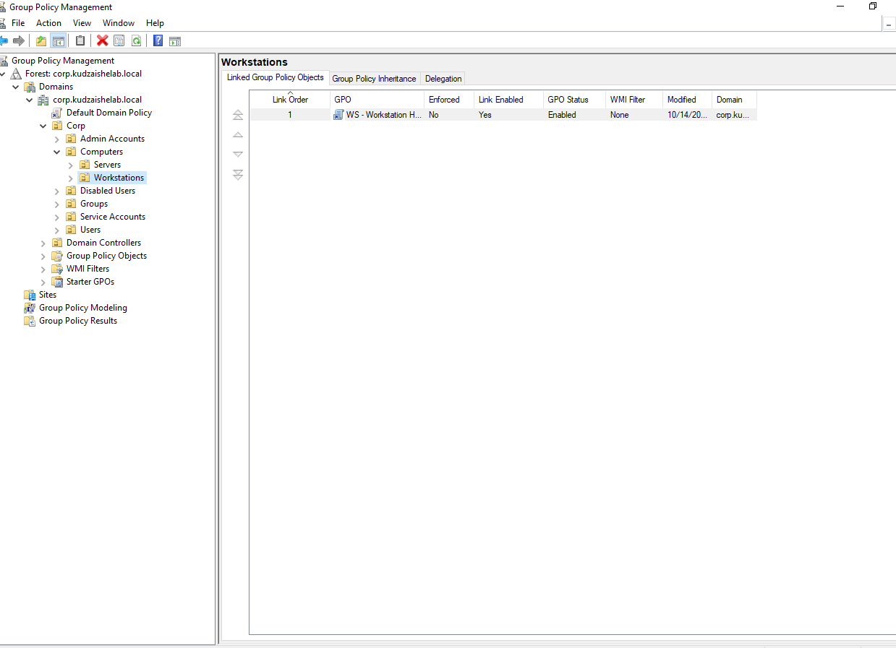
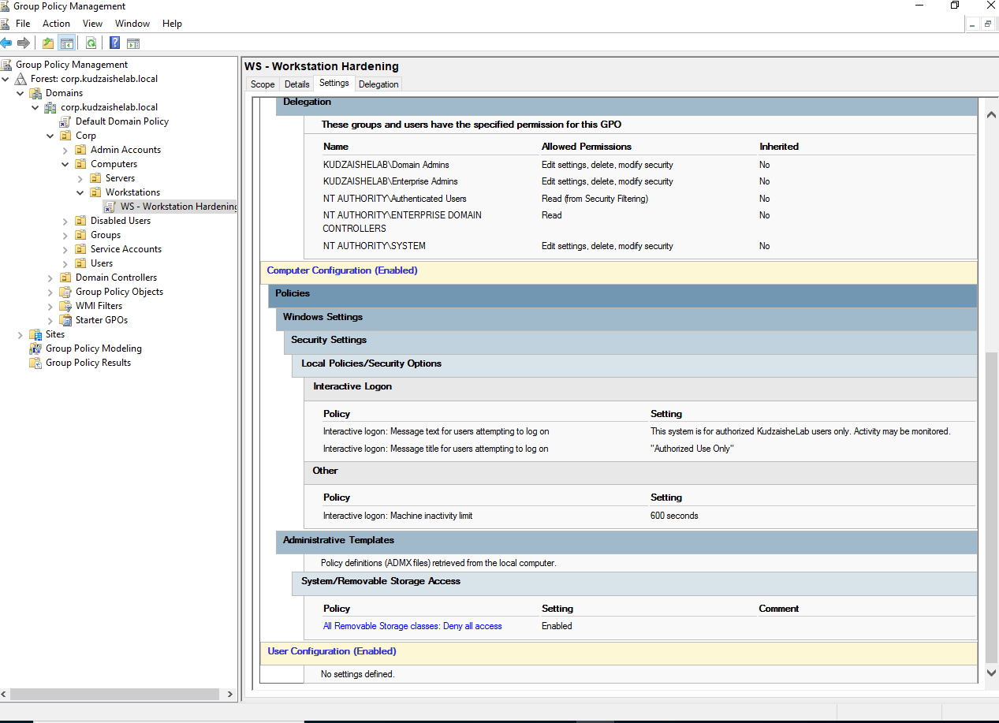
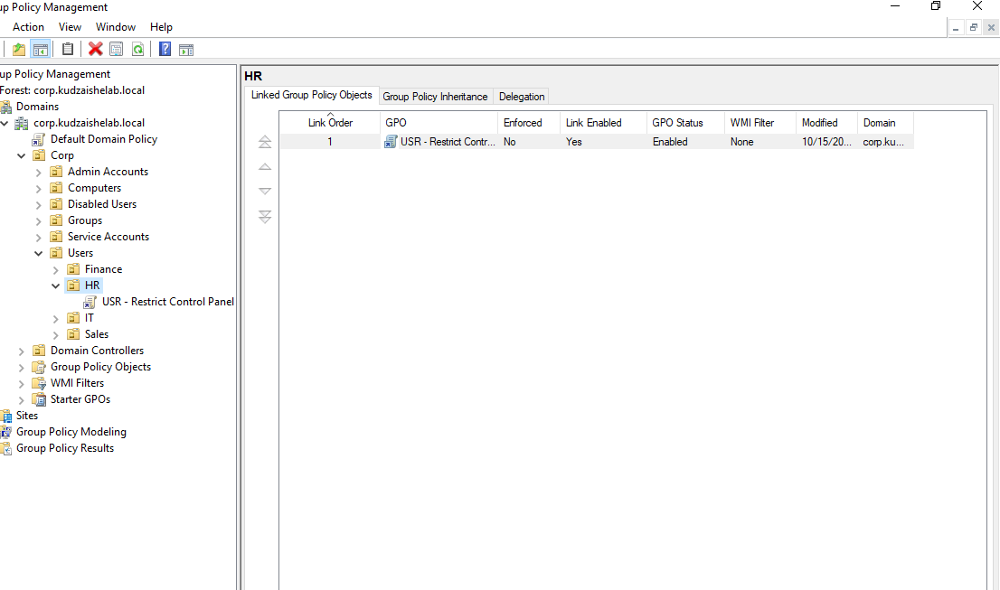
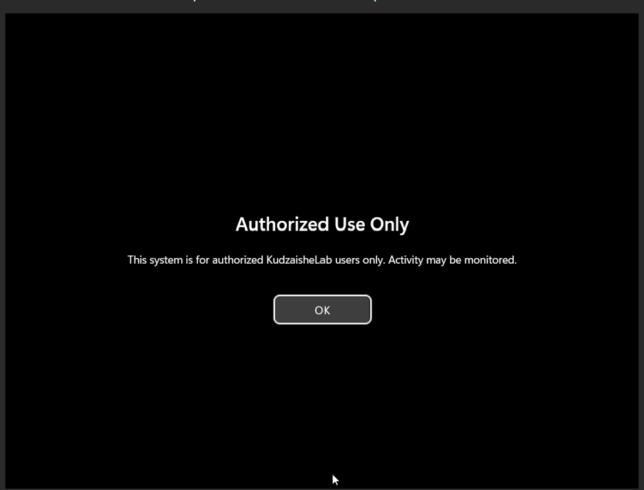

# Phase 3 – Endpoint Integration and Group Policy

**Enterprise Active Directory Home Lab · Phase 3 of 5**

In this phase I joined a **Windows 11 Enterprise workstation (CLIENT01)** to the domain and used **Group Policy** to enforce security from one central place: a domain-wide **password and lockout policy**, a stricter **fine-grained policy for admins**, **workstation hardening** (USB block, screen lock, logon banner), and a **Control Panel restriction** for every department except IT.

Every setting was verified on the client with `gpresult`, and the troubleshooting along the way is documented below.

---

## Contents

1. [Key terms](#key-terms)
2. [Design](#design)
3. [Build steps](#build-steps)
4. [Verification](#verification)
5. [Troubleshooting](#troubleshooting)
6. [Scripts](#scripts)
7. [Skills demonstrated](#skills-demonstrated)

---

## Key terms

| Term | Meaning |
|---|---|
| **Domain join** | Adding a computer to the domain so it trusts the domain controller for logons and receives Group Policy. |
| **Group Policy Object (GPO)** | A collection of settings pushed from the domain controller to users and computers. |
| **GPO link** | A GPO only takes effect where it is **linked**: a site, the domain, or an OU. Objects inside that location receive it. |
| **Computer vs User Configuration** | Computer settings apply to the machine at startup, whatever user logs in. User settings follow the user at logon, on any domain computer. |
| **Default Domain Policy** | The built-in GPO linked to the whole domain. It holds the domain-wide password and lockout policy. |
| **Fine-Grained Password Policy (PSO)** | A Password Settings Object that applies different password rules to specific users or groups, overriding the domain policy. |
| **Account lockout** | Temporarily disabling logon after too many wrong passwords, to slow down password-guessing attacks. |
| **gpupdate / gpresult** | `gpupdate /force` fetches policy immediately. `gpresult` reports which GPOs applied, which were filtered out, and why. |
| **RSoP** | Resultant Set of Policy: the final combined result of every GPO that applies to a user and computer. `gpresult` shows it. |
| **APIPA (169.254.x.x)** | The address Windows assigns itself when it can't reach a DHCP server. A sign of a network or DHCP problem. |
| **TPM 2.0 / Secure Boot / UEFI** | Hardware security features Windows 11 requires. In VirtualBox they are enabled per VM. |

---

## Design

### Where each policy applies



| GPO | Linked to | Type | What it enforces |
|---|---|---|---|
| **Default Domain Policy** | Whole domain | Computer | 12+ character complex passwords, 90-day max age, 24-password history, lockout after 5 attempts for 15 minutes |
| **Admins-PSO** *(fine-grained policy)* | Domain Admins group | Password policy | 15+ character passwords, lockout after 3 attempts |
| **WS - Workstation Hardening** | Workstations OU | Computer | All removable storage blocked, screen lock after 10 minutes, "Authorized Use Only" logon banner |
| **USR - Restrict Control Panel** | Finance, HR, Sales OUs | User | Control Panel and PC Settings blocked; IT left unrestricted |

### CLIENT01

| Setting | Value |
|---|---|
| OS | Windows 11 Enterprise (evaluation) |
| Hardware | 4 GB RAM · 2 vCPU · 64 GB disk · UEFI · TPM 2.0 · Secure Boot |
| Network | NAT Network `CorpLab` · address from DC01's DHCP scope |
| Location in AD | `Corp/Computers/Workstations` |

---

## Build steps

### 1. Build the Windows 11 client

Created CLIENT01 in VirtualBox with **UEFI, TPM 2.0 and Secure Boot** (Windows 11 requirements), attached it to the `CorpLab` network, and installed Windows 11 Enterprise. During setup, **Domain join instead** creates a temporary local account rather than a Microsoft account.

### 2. Confirm networking before joining

A domain join fails if the client can't find the domain through DNS, so this is checked first:

```powershell
ipconfig /all
nslookup corp.kudzaishelab.local
```

The client received `10.0.10.100` from **DC01's DHCP scope**, with DNS `10.0.10.10`, and resolved the domain to the DC.



### 3. Join the domain and place the computer correctly

Joined through **System Properties → Change → Domain**, using the separate admin account from Phase 2. Then, on DC01, moved CLIENT01 from the default `Computers` **container** into the `Workstations` **OU**, because Group Policy can't be linked to the default container.

```powershell
Add-Computer -DomainName "corp.kudzaishelab.local" -NewName "CLIENT01" `
  -Credential "KUDZAISHELAB\adm-kudzaishe" -Restart

Get-ADComputer CLIENT01 |
  Move-ADObject -TargetPath "OU=Workstations,OU=Computers,OU=Corp,DC=corp,DC=kudzaishelab,DC=local"
```

The first domain logon as a Phase 2 user (`tmoyo`) forced a password change, confirming the provisioning rules work end to end.




### 4. Domain password and lockout policy

Edited the **Default Domain Policy** → Computer Configuration → Policies → Windows Settings → Security Settings → **Account Policies**:

- **Password Policy:** minimum length 12, complexity enabled, maximum age 90 days, history 24
- **Account Lockout Policy:** threshold 5 attempts, duration 15 minutes, reset counter after 15 minutes

Then a **fine-grained password policy** gives admins stricter rules than everyone else:

```powershell
New-ADFineGrainedPasswordPolicy -Name "Admins-PSO" -Precedence 10 `
  -MinPasswordLength 15 -ComplexityEnabled $true -LockoutThreshold 3 -PasswordHistoryCount 24
Add-ADFineGrainedPasswordPolicySubject -Identity "Admins-PSO" -Subjects "Domain Admins"
```


### 5. Workstation hardening

Created **WS - Workstation Hardening** and linked it to the Workstations OU:

| Setting | Location in the editor | Value |
|---|---|---|
| All Removable Storage classes: Deny all access | Administrative Templates → System → Removable Storage Access | Enabled |
| Interactive logon: Machine inactivity limit | Security Settings → Local Policies → Security Options | 600 seconds |
| Interactive logon: Message title | Security Options | "Authorized Use Only" |
| Interactive logon: Message text | Security Options | "This system is for authorized KudzaisheLab users only. Activity may be monitored." |




### 6. Restrict Control Panel by department

Created **USR - Restrict Control Panel** (User Configuration → Administrative Templates → Control Panel → **Prohibit access to Control Panel and PC settings**) and linked it to the **Finance, HR and Sales** OUs. **IT is deliberately excluded**, because IT staff need these tools.

Linking one GPO to several OUs means one place to change the setting for every department it covers.



---

## Verification

| Check | How | Result |
|---|---|---|
| Client addressing | `ipconfig /all` on CLIENT01 | IP from the `10.0.10.100–200` scope, DNS `10.0.10.10` |
| Domain membership | System Properties | Member of `corp.kudzaishelab.local` |
| Policies applied | `gpupdate /force`, then `gpresult /r` | Computer: Default Domain Policy, WS - Workstation Hardening · User: USR - Restrict Control Panel |
| Logon banner | Restart CLIENT01 | "Authorized Use Only" shown before the logon screen |
| Control Panel block | Log on as `tmoyo` (Finance), open Control Panel | Blocked by administrator |
| IT unaffected | Log on as `jcarter` (IT), open Control Panel | Opens normally |
| Admin password policy | `Get-ADUserResultantPasswordPolicy adm-kudzaishe` | Returns `Admins-PSO` |




---

## Troubleshooting

Phase 3 produced the most real-world troubleshooting of the lab. Each issue is listed with how I found the cause.

| Symptom | Diagnosis | Fix |
|---|---|---|
| CLIENT01 showed a black screen at boot | The VM's display adapter was incompatible with the Windows 11 installer | Changed the graphics controller from VBoxSVGA to **VMSVGA** and turned off 3D acceleration |
| Windows had nowhere to install | Storage settings showed two optical drives and **no virtual hard disk** | Created a 64 GB VDI and attached it to the SATA controller |
| Client got a `169.254.x.x` address | APIPA: no DHCP answer. DC01 was offline when the client first asked | Started DC01, confirmed the DHCP service and AD authorization, then `ipconfig /release` and `/renew` |
| `nslookup` timed out | DC01's network profile had reverted to **Public**, so its firewall blocked DNS (the same issue as Phase 1) | Reset the adapter so the profile returned to DomainAuthenticated |
| Workstation policies never applied | `gpresult` listed only the Default Domain Policy: CLIENT01 was still in the default `Computers` container, outside any OU with a linked GPO | Moved CLIENT01 into the Workstations OU |
| Control Panel policy missing | The GPO didn't appear in Group Policy Management after the host ran out of disk space mid-session | Recreated it, then confirmed every other GPO via its **Settings** report |
| Password policy report showed a 7-character minimum and a 90-day **minimum** age | Reviewing the Default Domain Policy **Settings** report: the length change hadn't saved, and 90 days went into *minimum* age instead of *maximum*, which would stop users changing their password for 90 days | Set minimum age to 1 day, maximum age to 90 days and minimum length to 12, then re-checked the report |
| Group Policy Results Wizard failed with "RPC server is unavailable" | Windows 11's firewall blocks remote management from DC01 by default | Ran `gpresult` locally on CLIENT01 instead |
| `gpresult /h` returned "does not have RSoP data" | The elevated window ran as Administrator, who had never logged on to CLIENT01 | Added `/user KUDZAISHELAB\tmoyo` to report on a user who had |

**Key takeaway:** Group Policy follows **where an object lives**, not what it's called. When a policy doesn't apply, `gpresult` and the object's OU are the first two things to check.

---

## Scripts

The lab was configured mainly through the GUI. These scripts reproduce the same configuration in PowerShell, so it can be rebuilt quickly.

| File | Purpose |
|---|---|
| [`01-join-domain.ps1`](scripts/01-join-domain.ps1) | Network checks, domain join, and moving CLIENT01 into the Workstations OU |
| [`02-password-policies.ps1`](scripts/02-password-policies.ps1) | Domain password and lockout policy, plus the Admins-PSO fine-grained policy |
| [`03-create-gpos.ps1`](scripts/03-create-gpos.ps1) | Creates and links WS - Workstation Hardening and USR - Restrict Control Panel |
| [`04-verify-on-client.ps1`](scripts/04-verify-on-client.ps1) | Forces a policy refresh and produces `gpresult` reports |

---

## Skills demonstrated

Windows 11 deployment · domain join and computer object management · Group Policy design, linking and scoping · password and account lockout policy · fine-grained password policies · endpoint hardening · `gpupdate` / `gpresult` troubleshooting · DHCP and DNS diagnosis

**GRC alignment:** NIST IA-5 Authenticator Management · NIST AC-7 Unsuccessful Logon Attempts · NIST AC-8 System Use Notification · NIST AC-11 Device Lock · NIST MP-7 Media Use · NIST CM-6 Configuration Settings · CIS Control 4 Secure Configuration · CIS 5.2 Use Unique Passwords

---

**← [Phase 2: Identity structure](../phase-2-identity/)** · **Next → Phase 4: Access control** *(coming soon)*
