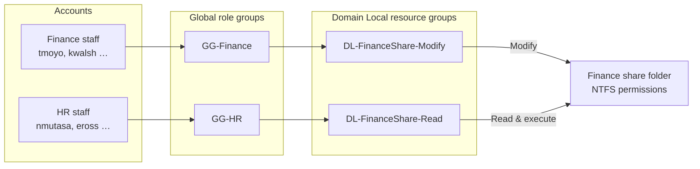
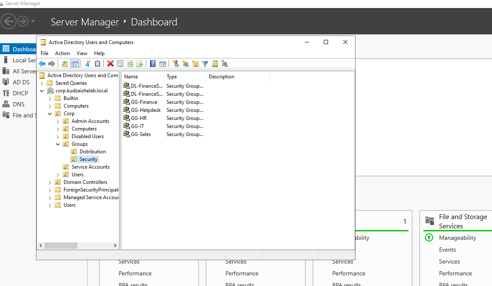
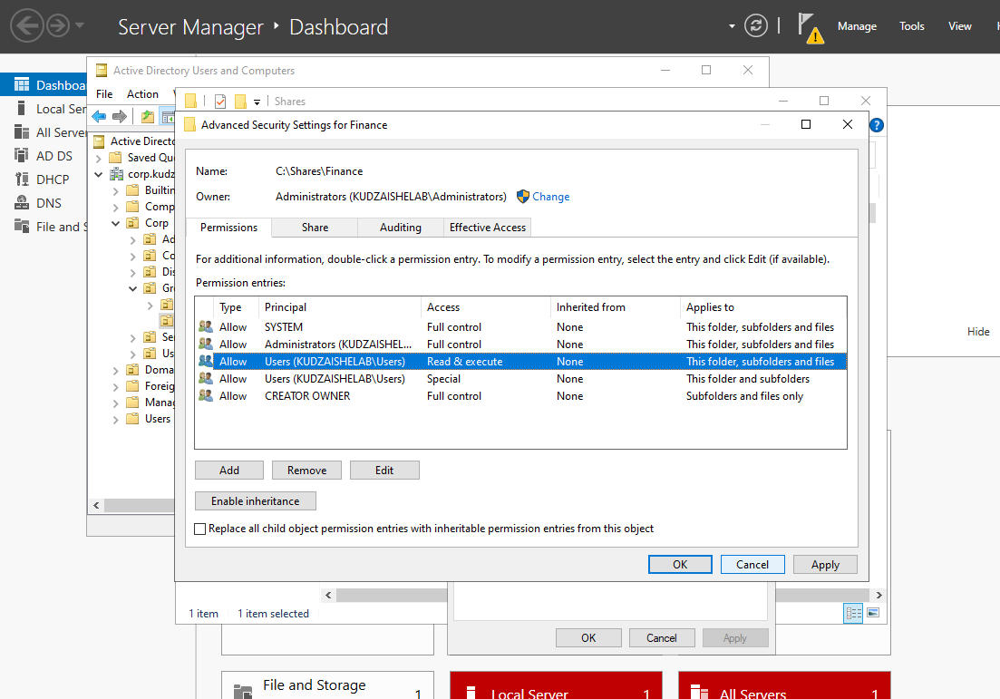
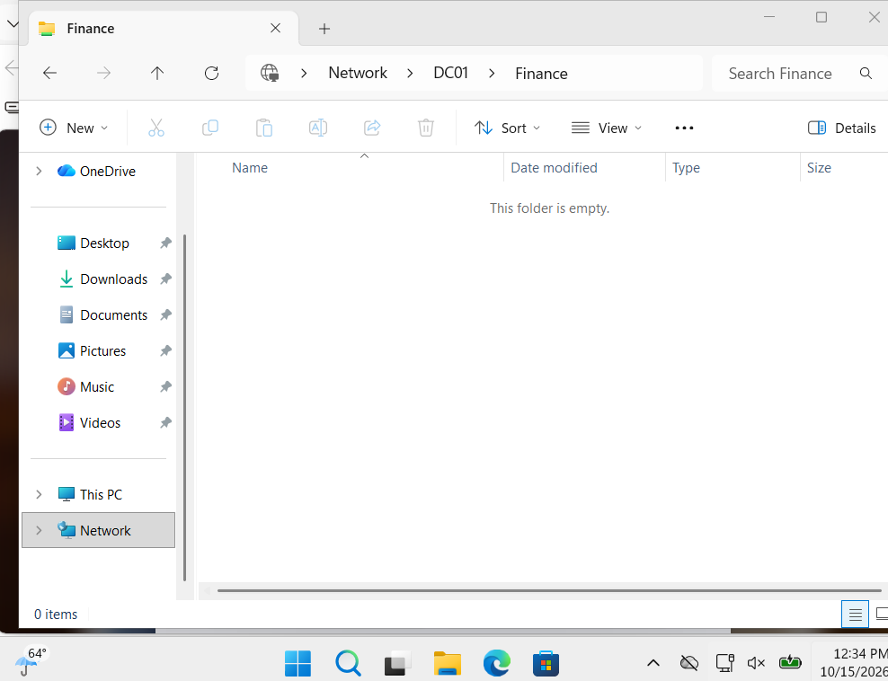
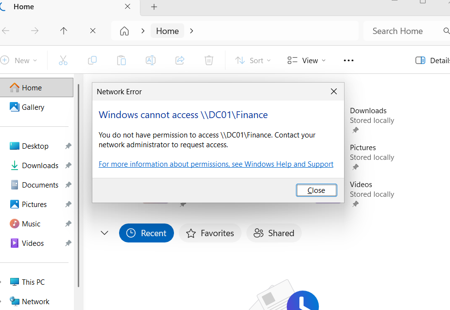

# Phase 4 – Access Control

**Enterprise Active Directory Home Lab · Phase 4 of 5**

In this phase I secured a **Finance file share** so that access is controlled entirely through **groups**, never by adding individual users. Then I proved it worked with three tests: **Finance can edit**, **HR is denied**, and **one group change gives HR read-only access**, with no folder permissions touched.

This completes the **AGDLP** model started in Phase 2: accounts → global role groups → domain local resource groups → permissions.

---

## Contents

1. [Key terms](#key-terms)
2. [Design](#design)
3. [Build steps](#build-steps)
4. [Access tests](#access-tests)
5. [Lessons learned](#lessons-learned)
6. [Scripts](#scripts)
7. [Skills demonstrated](#skills-demonstrated)

---

## Key terms

| Term | Meaning |
|---|---|
| **Least privilege** | Every user gets the minimum access their role needs, and nothing more. |
| **Share permissions** | Permissions on the network share (`\\DC01\Finance`). They apply only when the folder is reached over the network. |
| **NTFS permissions** | Permissions on the folder itself. They apply both over the network and when signed in locally. |
| **Effective access** | Over the network, a user gets the **more restrictive** of the share and NTFS permissions. |
| **Inheritance** | By default a folder copies its parent's permissions. Disabling it lets the folder have its own, tighter set. |
| **Domain Local group** | A group used to grant permissions on a resource. In AGDLP, only these groups appear on folder permissions. |
| **Group nesting** | Placing one group inside another (`GG-Finance` inside `DL-FinanceShare-Modify`), so members inherit the access. |
| **Modify vs Read & execute** | *Modify* allows reading, creating, editing and deleting files. *Read & execute* allows opening and reading only. |
| **Access token** | The list of a user's group memberships, built at sign-in. Group changes take effect only after the user signs in again. |
| **UNC path** | A network path in the form `\\Server\Share`. |

---

## Design

### The AGDLP chain, complete



Folder permissions only ever reference the two **DL** groups. Who gets access is decided entirely by group membership in Active Directory.

### Permissions on the Finance share

| Layer | Principal | Access |
|---|---|---|
| **Share** | Authenticated Users | Full Control *(NTFS does the real filtering)* |
| **NTFS** | SYSTEM | Full control |
| **NTFS** | Administrators | Full control |
| **NTFS** | CREATOR OWNER | Full control (subfolders and files) |
| **NTFS** | DL-FinanceShare-Modify | Modify |
| **NTFS** | DL-FinanceShare-Read | Read & execute |

The common practice of opening the share permission and controlling access with NTFS means there's **one place to manage access**, and it applies the same way locally and over the network.

---

## Build steps

### 1. Create the resource groups

Two **Domain Local** groups in `Corp/Groups/Security`, then nest the Finance role group inside the Modify group:

```powershell
New-ADGroup -Name "DL-FinanceShare-Modify" -GroupScope DomainLocal -GroupCategory Security -Path $sec
New-ADGroup -Name "DL-FinanceShare-Read"   -GroupScope DomainLocal -GroupCategory Security -Path $sec
Add-ADGroupMember -Identity "DL-FinanceShare-Modify" -Members "GG-Finance"
```



### 2. Create and share the folder

Created `C:\Shares\Finance` and shared it as **Finance** (Properties → Sharing → Advanced Sharing). The default *Everyone* entry was removed and **Authenticated Users** given Full Control at the share level.

### 3. Lock down the NTFS permissions

In **Properties → Security → Advanced**:

1. **Disabled inheritance**, converting the inherited entries into explicit ones
2. **Removed both `Users` entries**, which would have given every domain user read access
3. **Added** `DL-FinanceShare-Modify` with **Modify** and `DL-FinanceShare-Read` with **Read & execute**



---

## Access tests

Each test was run on **CLIENT01** by signing in as a different domain user and opening `\\DC01\Finance`.

| # | User | Department | Group path | Expected | Result |
|:-:|---|---|---|---|---|
| 1 | `tmoyo` | Finance | GG-Finance → DL-FinanceShare-Modify | Read and write | ✅ Created `budget.txt` |
| 2 | `nmutasa` | HR | none | Denied | ✅ "You do not have permission" |
| 3 | `nmutasa` | HR | GG-HR → DL-FinanceShare-Read *(after one change)* | Read only | ✅ Opened the file, blocked from creating one |

**Test 1: Finance can edit**



**Test 2: HR is denied**



**Test 3: One group change grants HR read-only access**

On DC01, `GG-HR` was added to `DL-FinanceShare-Read`. After nmutasa signed out and back in, she could open `budget.txt` but couldn't create a new file.

```powershell
Add-ADGroupMember -Identity "DL-FinanceShare-Read" -Members "GG-HR"
```

---

## Lessons learned

- **Inheritance is the hidden risk.** A new folder under `C:\` inherits a `Users` read entry, so every domain user could browse Finance files until it was removed. Checking the Advanced view, not just the summary list, caught it.
- **Group changes need a fresh sign-in.** nmutasa kept her old access until she signed out, because group memberships are read into the access token at logon. This is also why removing access during offboarding should be paired with ending active sessions.
- **The share and the folder are different places.** Testing in the local `Documents` folder by mistake proved nothing; the test only counts when it's run against `\\DC01\Finance`.
- **AGDLP scales.** Giving a whole department read access took one command and zero permission edits. Removing it later is just as simple, which makes access reviews and audits far easier.

---

## Scripts

The lab was configured mainly through the GUI. These scripts reproduce the same setup and add an access review.

| File | Purpose |
|---|---|
| [`01-create-resource-groups.ps1`](scripts/01-create-resource-groups.ps1) | Creates the two DL groups and nests GG-Finance |
| [`02-create-finance-share.ps1`](scripts/02-create-finance-share.ps1) | Creates the folder, the share and the NTFS permissions |
| [`03-grant-hr-read-access.ps1`](scripts/03-grant-hr-read-access.ps1) | Grants HR read-only access with one group change |
| [`04-access-review.ps1`](scripts/04-access-review.ps1) | Reports share permissions, NTFS permissions and effective members |

---

## Skills demonstrated

NTFS and share permissions · AGDLP group design · group nesting · least-privilege access control · positive and negative access testing · access review reporting · PowerShell (`icacls`, `Get-Acl`, SMB cmdlets)

**GRC alignment:** NIST AC-3 Access Enforcement · NIST AC-6 Least Privilege · NIST AC-2 Account Management (access reviews) · CIS Control 3.3 Configure Data Access Control Lists · CIS Control 6 Access Control Management

---

**← [Phase 3: Endpoint integration and Group Policy](../phase-3-group-policy/)** · **Next → Phase 5: IAM lifecycle and auditing** *(coming soon)*
