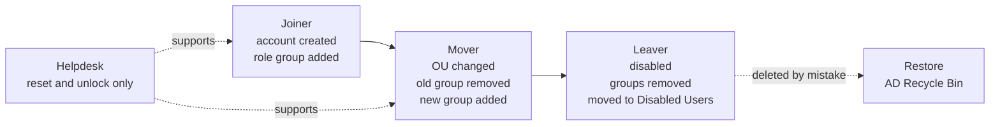
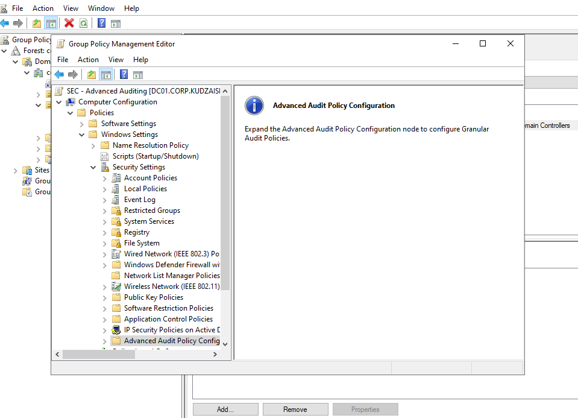
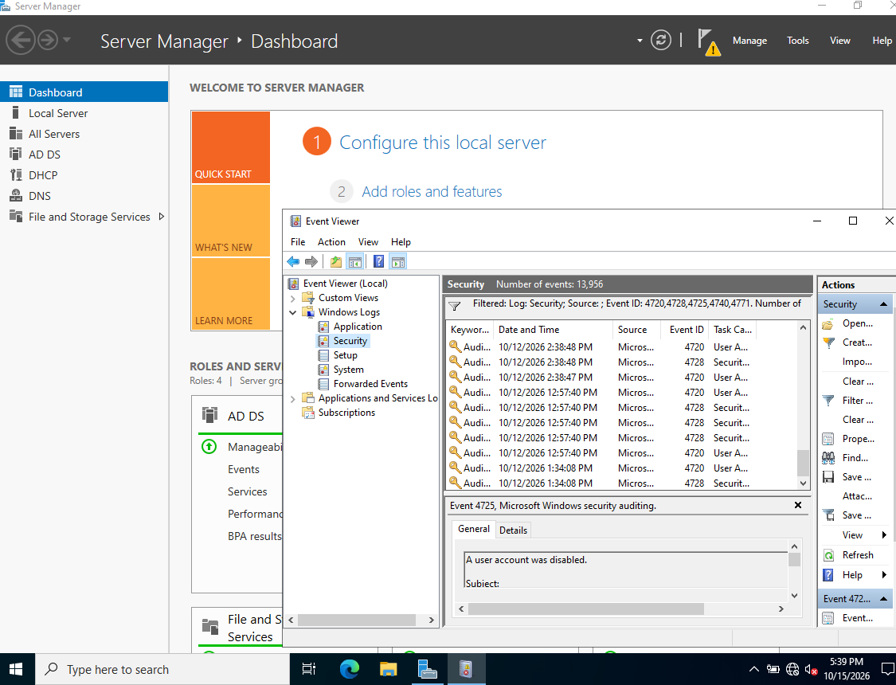
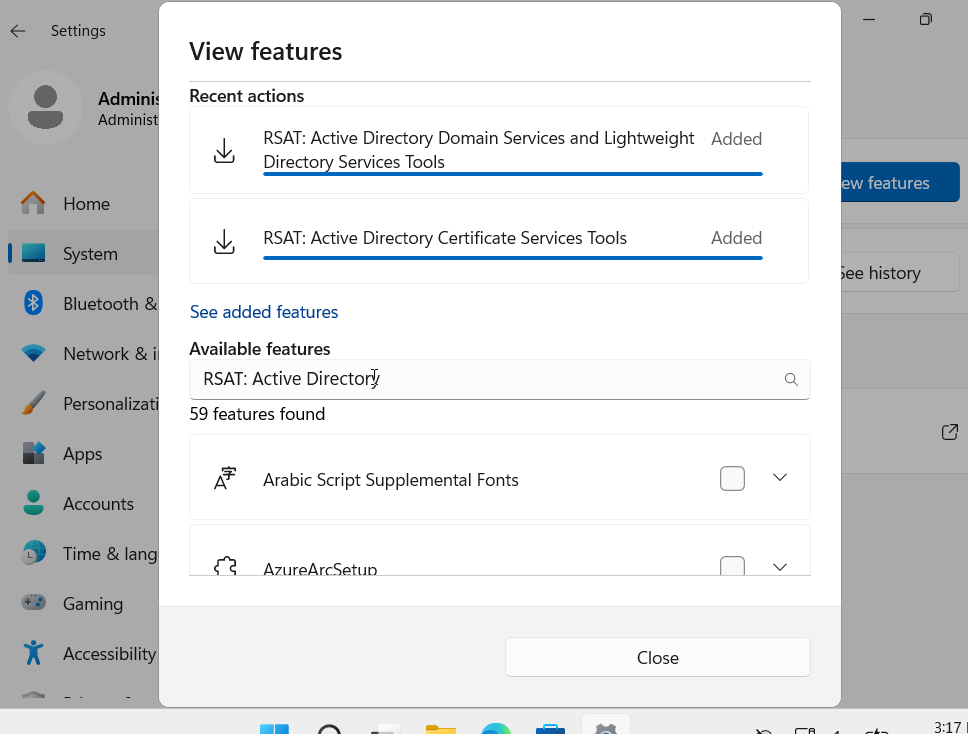
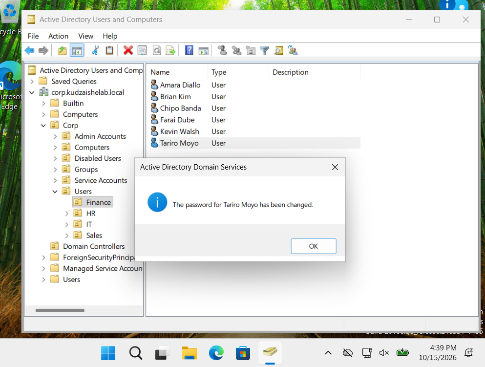
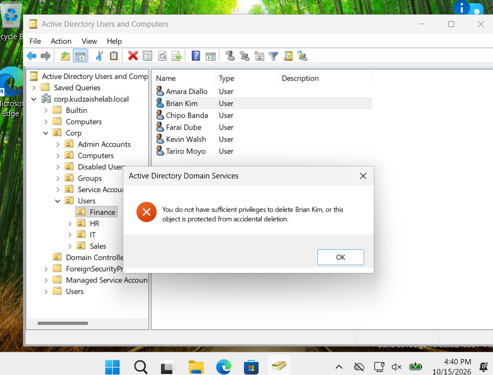
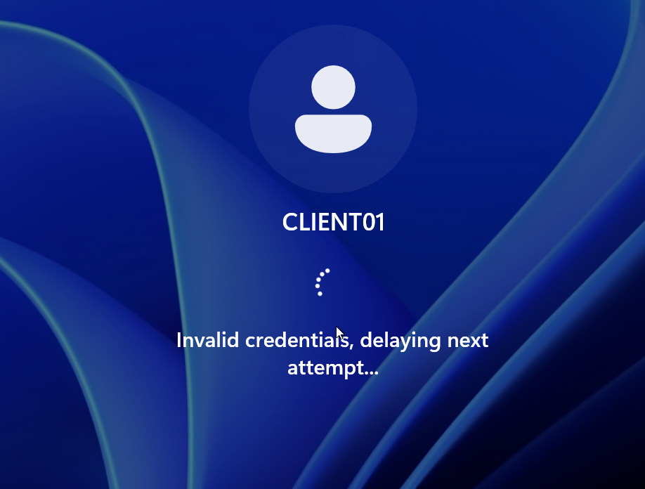
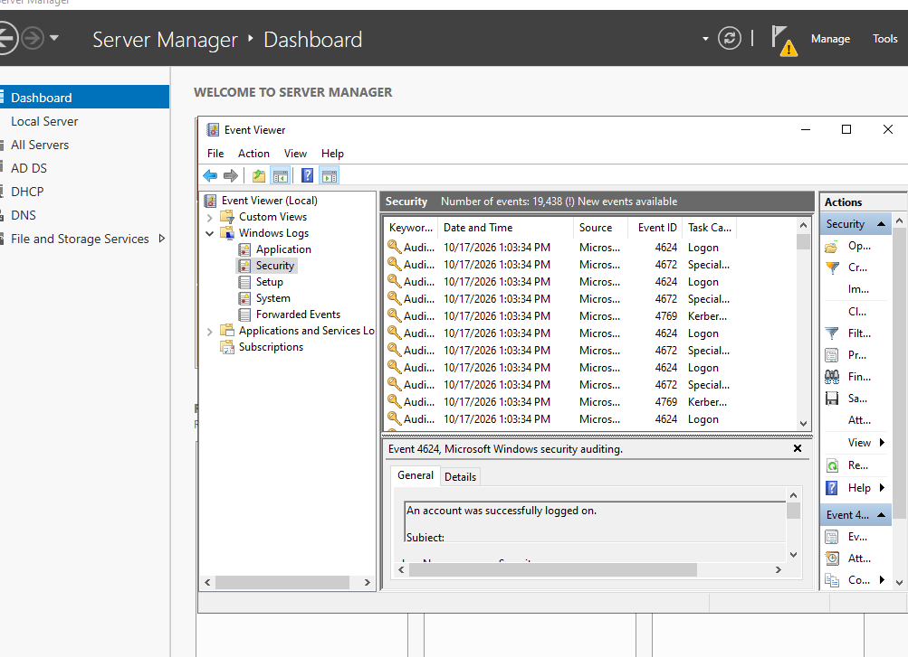

# Phase 5 – IAM Lifecycle and Auditing

**Enterprise Active Directory Home Lab · Phase 5 of 5**

In this final phase I ran the identity scenarios that make up day-to-day IAM work: **joiner, mover and leaver**, **helpdesk delegation**, **account lockout recovery** and **deleted-user restore**. Security auditing came first, so every change left evidence in the Security log.

The phase answers three questions an auditor would ask: *who has access, how did they get it, and can you prove when it changed?*

---

## Contents

1. [Key terms](#key-terms)
2. [Design](#design)
3. [Auditing first](#1-auditing-first)
4. [Identity scenarios](#identity-scenarios)
5. [Evidence summary](#evidence-summary)
6. [Lessons learned](#lessons-learned)
7. [Scripts](#scripts)
8. [Skills demonstrated](#skills-demonstrated)

---

## Key terms

| Term | Meaning |
|---|---|
| **Joiner / Mover / Leaver (JML)** | The three stages of an identity's life: starting, changing role, and leaving. Each needs access granted, adjusted or removed. |
| **Access creep** | Access that builds up when a mover gains new rights but keeps the old ones. |
| **Delegation** | Giving a group a narrow administrative right (such as resetting passwords) on specific OUs, without making them domain admins. |
| **RSAT** | Remote Server Administration Tools. Lets an admin or helpdesk technician manage AD from a workstation instead of signing in to the domain controller. |
| **Account lockout** | An account is locked automatically after too many failed sign-ins. Here that's **5 attempts** (set in Phase 3). |
| **AD Recycle Bin** | Keeps deleted objects with their attributes and group memberships, so they can be restored intact. Enabled in Phase 1. |
| **Advanced audit policy** | Detailed audit categories (such as *User Account Management*) that decide which events are written to the Security log. |
| **Event ID** | The number that identifies a type of Security log event, such as 4740 for an account lockout. |

---

## Design

### The identity lifecycle



### Events captured

| Event ID | What it records | Scenario |
|:-:|---|---|
| **4720** | A user account was created | Joiner |
| **4728** | A member was added to a security-enabled global group | Joiner, mover |
| **4729** | A member was removed from a security-enabled global group | Mover, leaver |
| **4725** | A user account was disabled | Leaver |
| **4724** | An attempt was made to reset an account's password | Helpdesk |
| **4771** | Kerberos pre-authentication failed (wrong password) | Lockout |
| **4740** | A user account was locked out | Lockout |
| **4624** | An account was successfully logged on | Sign-in after recovery |

---

## 1. Auditing first

I created a dedicated GPO, **SEC - Advanced Auditing**, and linked it to the **Domain Controllers** OU. Keeping auditing in its own GPO means it can be reviewed and changed without touching the default policies.

Under *Computer Configuration → Policies → Windows Settings → Security Settings → Advanced Audit Policy Configuration*:

| Category | Subcategory | Audit |
|---|---|---|
| Account Management | User Account Management | Success, Failure |
| Account Management | Security Group Management | Success, Failure |
| Account Logon | Kerberos Authentication Service | Success, Failure |
| Logon/Logoff | Logon | Success, Failure |
| Logon/Logoff | Account Lockout | Success, Failure |



Then I applied it with `gpupdate /force` and confirmed it with `auditpol /get /category:*` on DC01. From this point, every identity change in the lab was recorded.



*The Security log filtered to Event IDs 4720, 4728, 4725, 4740 and 4771: account creations and group additions from provisioning, and the leaver's account being disabled (4725).*

---

## Identity scenarios

### 2. Joiner: new hire

A new hire was created in their department OU, added to the matching role group, and set to change the temporary password at first sign-in. Because access is group-based, they got exactly what their department gets on day one, and nothing more.

```powershell
New-ADUser -Name $name -SamAccountName $sam -Department $dept `
  -Path "OU=$dept,OU=Users,$corp" -AccountPassword $temp -ChangePasswordAtLogon $true -Enabled $true
Add-ADGroupMember -Identity "GG-$dept" -Members $sam
```

**Evidence:** 4720 (account created) and 4728 (added to the role group).

### 3. Mover: changing department

A user moved between departments. The account was moved to the new department OU, **removed from the old role group** and added to the new one. Removing the old group is the step that prevents access creep.

```powershell
Move-ADObject -Identity $user.DistinguishedName -TargetPath "OU=$to,OU=Users,$corp"
Remove-ADGroupMember -Identity "GG-$from" -Members $sam -Confirm:$false
Add-ADGroupMember    -Identity "GG-$to"   -Members $sam
```

After signing in again, the user had the new department's access and lost the old one, with no folder permissions touched.

**Evidence:** 4729 (removed from the old group) and 4728 (added to the new group).

### 4. Leaver: offboarding

Offboarding followed a standard checklist:

1. **Disabled** the account (it isn't deleted straight away, so it can be investigated or restored)
2. **Reset** the password to a random value
3. **Removed** all group memberships except Domain Users
4. **Moved** the account to `Corp/Disabled Users`, with the leave date in the description

**Evidence:** 4725 (account disabled), shown in the Security log above, and 4729 (removed from groups).

### 5. Helpdesk delegation

Helpdesk technicians need to reset passwords and unlock accounts, but should never be domain admins. Using the **Delegation of Control Wizard** on `Corp/Users`, `GG-Helpdesk` was granted only:

- **Reset user passwords and force password change at next logon**
- **Read and write the `lockoutTime` attribute** (to unlock accounts)

I installed **RSAT** on CLIENT01 so the helpdesk could work from a workstation, never signing in to the domain controller.



Then I tested the delegation from CLIENT01:

| Action | Result |
|---|---|
| Reset a Finance user's password (Tariro Moyo) | ✅ Allowed |
| Unlock a locked account | ✅ Allowed |
| Delete a user (Brian Kim) | ❌ Insufficient privileges |





The denied delete matters as much as the successful reset: the helpdesk can do its job, but can't do damage beyond it.

### 6. Account lockout and recovery

On CLIENT01 I signed in as **tmoyo** with the wrong password **5 times**. Each attempt was rejected, and on the fifth the account locked, matching the Phase 3 lockout policy.



On DC01, the Security log recorded **4771** for each failed attempt, then **4740** naming the locked account and the computer it was locked from (CLIENT01). The account was unlocked and the password reset in Active Directory Users and Computers, and tmoyo signed in successfully (4624).

```powershell
Search-ADAccount -LockedOut | Select-Object Name, SamAccountName
Unlock-ADAccount -Identity tmoyo
```

Event 4740 is the one to know in a SOC or IAM role: the **Caller Computer Name** shows where the failed attempts came from, which separates a user who forgot their password from someone guessing it.



### 7. Deleted-user restore

To simulate an accidental deletion, a test account was deleted, then restored from the **AD Recycle Bin**:

```powershell
Get-ADObject -Filter 'samAccountName -eq "<user>"' -IncludeDeletedObjects |
  Restore-ADObject
```

The account came back in its original OU with its attributes and group memberships intact. Without the Recycle Bin, this would need an authoritative restore from backup in Directory Services Restore Mode.

---

## Evidence summary

| Scenario | Action | Event IDs | Result |
|---|---|:-:|:-:|
| Joiner | Account created, added to role group | 4720, 4728 | ✅ |
| Mover | Department changed, old group removed | 4729, 4728 | ✅ |
| Leaver | Disabled, groups removed, moved to Disabled Users | 4725, 4729 | ✅ |
| Helpdesk | Reset allowed, delete denied | 4724 | ✅ |
| Lockout | Locked after 5 failed attempts, then recovered | 4771, 4740, 4624 | ✅ |
| Restore | Deleted user recovered intact | — | ✅ |

---

## Lessons learned

- **Turn on auditing before you need it.** Events that weren't being audited can't be found later. The audit GPO had to be in place before the first scenario, not after.
- **Movers are the real risk.** Joiners and leavers get attention; movers quietly collect access. Removing the old role group is the step that keeps least privilege intact.
- **Disable first, delete later.** A disabled account can be investigated or reinstated. A deleted one depends on the Recycle Bin.
- **Test what's denied, not just what's allowed.** The helpdesk reset working proves the delegation; the delete failing proves it's scoped correctly.
- **4740 tells you where, not just who.** The caller computer name turns a lockout from a nuisance into a lead.

---

## Scripts

The lab was run mainly through the GUI. These scripts reproduce each scenario.

| File | Purpose |
|---|---|
| [`01-enable-auditing.ps1`](scripts/01-enable-auditing.ps1) | Enables and verifies the audit subcategories on DC01 |
| [`02-joiner.ps1`](scripts/02-joiner.ps1) | Creates a new hire in the right OU and role group |
| [`03-mover.ps1`](scripts/03-mover.ps1) | Moves a user between departments and swaps role groups |
| [`04-leaver.ps1`](scripts/04-leaver.ps1) | Disables, strips groups and moves the account to Disabled Users |
| [`05-delegate-helpdesk.ps1`](scripts/05-delegate-helpdesk.ps1) | Grants GG-Helpdesk password reset and unlock rights only |
| [`06-lockout-investigation.ps1`](scripts/06-lockout-investigation.ps1) | Finds locked accounts, reads 4740 events and unlocks |
| [`07-restore-deleted-user.ps1`](scripts/07-restore-deleted-user.ps1) | Restores a deleted user from the AD Recycle Bin |
| [`08-audit-report.ps1`](scripts/08-audit-report.ps1) | Exports all lifecycle events to a CSV for review |

---

## Skills demonstrated

Identity lifecycle management (JML) · offboarding · access creep prevention · delegated administration · RSAT · account lockout investigation · AD Recycle Bin recovery · advanced audit policy · Windows Security log analysis · PowerShell automation

**GRC alignment:** NIST AC-2 Account Management · NIST AC-6 Least Privilege · NIST AC-7 Unsuccessful Logon Attempts · NIST AU-2 Event Logging · NIST AU-6 Audit Review · NIST PS-4 Personnel Termination · NIST PS-5 Personnel Transfer · CIS Control 5 Account Management · CIS Control 6 Access Control Management · CIS Control 8 Audit Log Management

---

**← [Phase 4: Access control](../phase-4-access-control/)** · **[Back to the project overview](../)**
